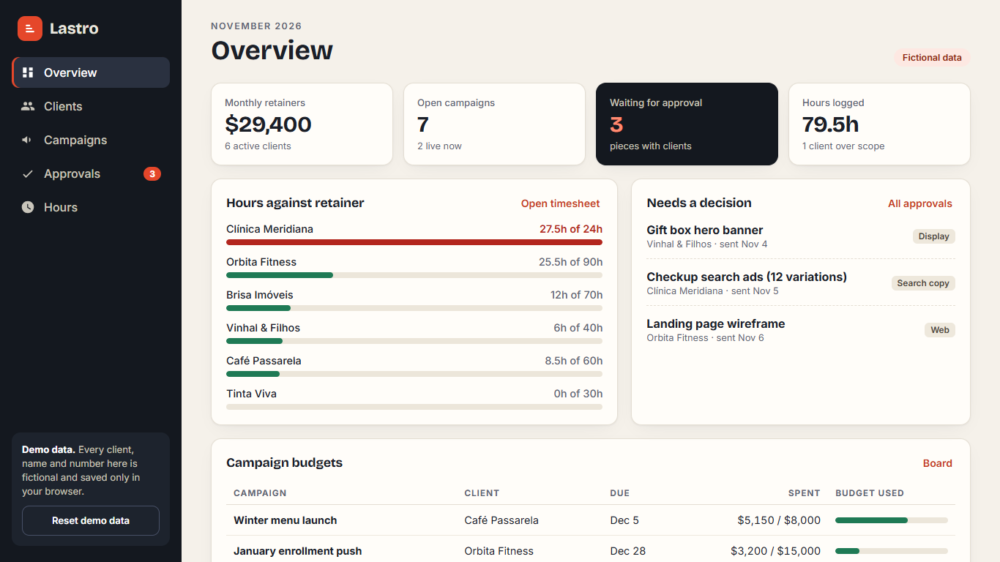
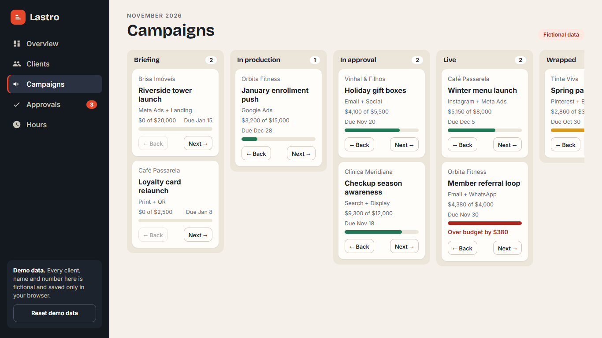
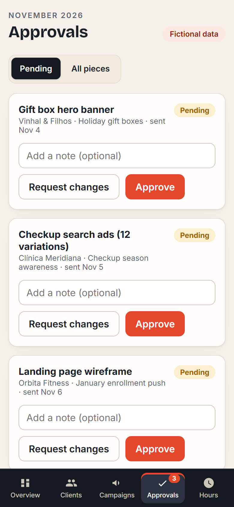

# Lastro · CRM for marketing agencies

Lastro keeps an agency's four daily questions in one place: **who are our clients, which campaigns are moving, what is waiting for client approval, and are we burning more hours than the retainer covers.**

> Portfolio demo. Every client, person and number is fictional and lives only in your browser (`localStorage`).

**Live demo:** https://alissonlittig.github.io/lastro-agencia-crm/

| Overview (desktop) | Campaigns board | Mobile |
|---|---|---|
|  |  |  |

## What it does

- **Overview:** monthly retainers, open campaigns, pieces waiting for approval, hours against each retainer, budget burn per campaign.
- **Clients:** searchable list, detail panel with scope usage, account health toggle, new-client form.
- **Campaigns:** five-column board (Briefing → In production → In approval → Live → Wrapped) with budget bars and over-budget warnings.
- **Approvals:** approve or request changes on each piece, with a note. Approving the last pending piece takes the campaign live; requesting changes sends it back to production.
- **Hours:** log time per client and campaign, billable flag, per-client balance against hours included, filterable timesheet.

## Stack

Preact 11 · TypeScript · Vite · Vitest. No backend, no tracking. Fonts (Bricolage Grotesque, Inter) are bundled.

```bash
npm install
npm run dev     # local dev server
npm test        # business rules (approval flow, hour balance, validation)
npm run build   # type-check + production build into dist/
```

Business rules live in `src/lib.ts` as pure functions (covered by `src/lib.test.ts`); the UI in `src/App.tsx` only renders state. Use "Reset demo data" in the sidebar to restore the seed.

## Quality

Lighthouse (local preview): accessibility 100, best practices 100, SEO 100, performance 90–98 depending on machine load. No horizontal scroll at 390 px; tables collapse into labelled rows on small screens.

CI (`.github/workflows/ci.yml`) runs tests and the build on every push and deploys `main` to GitHub Pages.

## License

MIT
